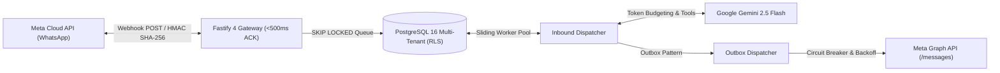

# 🏛️ Dominio de Arquitectura — Chatbot WS

> **Propósito:** Especificaciones técnicas, diseños de alto nivel, modelos de datos, arquitectura multi-tenant y estrategias de despliegue para la plataforma empresarial Chatbot WS.

---

## 📚 Documentos del Dominio

| Documento | Descripción | Nivel |
| :--- | :--- | :--- |
| [**`ARQUITECTURA_MULTITENANT_Y_ESCALABILIDAD.md`**](file:///c:/Users/indatech/Desktop/Chatbot%20WS/docs/architecture/ARQUITECTURA_MULTITENANT_Y_ESCALABILIDAD.md) | Aislamiento multi-tenant, Row-Level Security (RLS) en PostgreSQL, escalabilidad horizontal y pooling de conexiones. | L3 - Avanzado |
| [**`TDD_ARQUITECTURA_TECNICA_DETALLADA.md`**](file:///c:/Users/indatech/Desktop/Chatbot%20WS/docs/architecture/TDD_ARQUITECTURA_TECNICA_DETALLADA.md) | Technical Design Document (TDD) normativo v2.0: C4 Nivel 1 & 2, DDL PostgreSQL, FSM, Machine States y SLAs. | L2 - Núcleo |
| [**`GUIA_OMNICANAL_Y_DEALERS_AUTOMOTRICES.md`**](file:///c:/Users/indatech/Desktop/Chatbot%20WS/docs/architecture/GUIA_OMNICANAL_Y_DEALERS_AUTOMOTRICES.md) | Integración omnicanal y flujos conversacionales especializados en dealers automotrices (cotización, test drive, inventario). | L2 - Industria |
| [**`GUIA_ARQUITECTURA_Y_BUENAS_PRACTICAS.md`**](file:///c:/Users/indatech/Desktop/Chatbot%20WS/docs/architecture/GUIA_ARQUITECTURA_Y_BUENAS_PRACTICAS.md) | Manifiesto de ingeniería, catálogo de anti-patrones en LLMs, patrones de diseño de bots de alta concurrencia. | L1 - Fundacional |
| [**`DOSSIER_PROPUESTA_ARQUITECTURA_CHATBOT_WS.md`**](file:///c:/Users/indatech/Desktop/Chatbot%20WS/docs/architecture/DOSSIER_PROPUESTA_ARQUITECTURA_CHATBOT_WS.md) | Estudio de arquitectura de referencia, psicología conversacional, comparativas y justificación técnica. | L1 - Estratégico |
| [**`INFORME_DESPLIEGUE_VPS_Y_CLOUDFLARE_TUNNEL.md`**](file:///c:/Users/indatech/Desktop/Chatbot%20WS/docs/architecture/INFORME_DESPLIEGUE_VPS_Y_CLOUDFLARE_TUNNEL.md) | Configuración de infraestructura en producción (<VPS_PROVIDER> VPS, Systemd, Cloudflare Tunnels, TLS/SSL). | L2 - Operaciones |

---

## 🧭 Diagrama de Topología del Sistema

