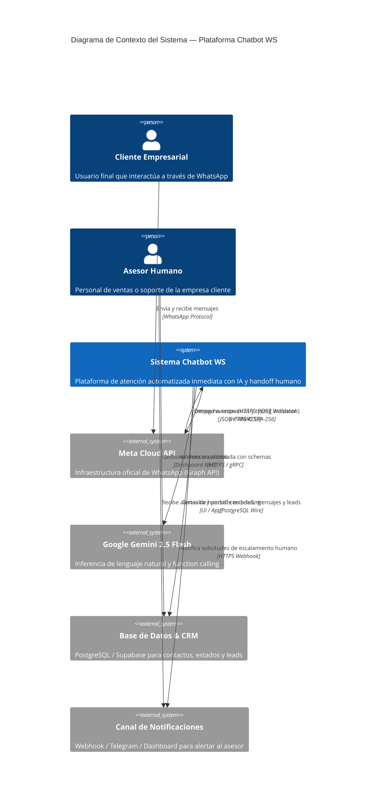
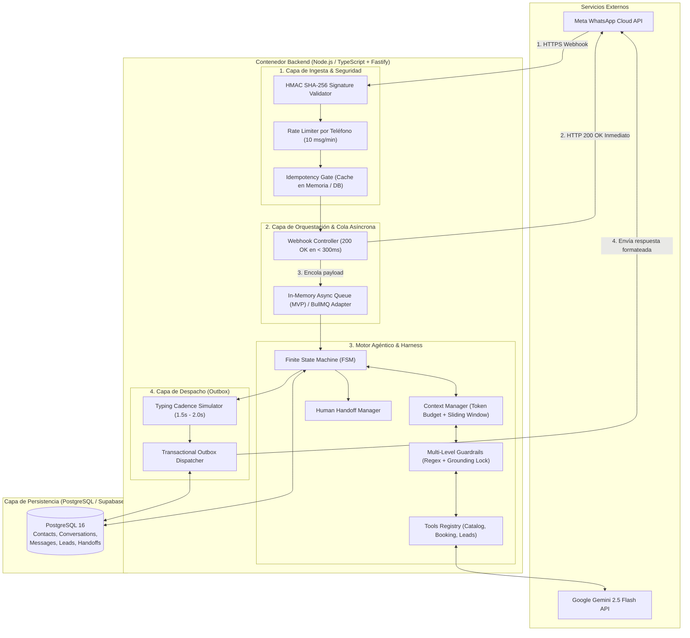
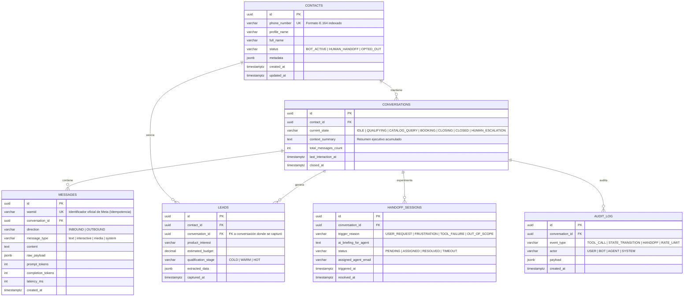
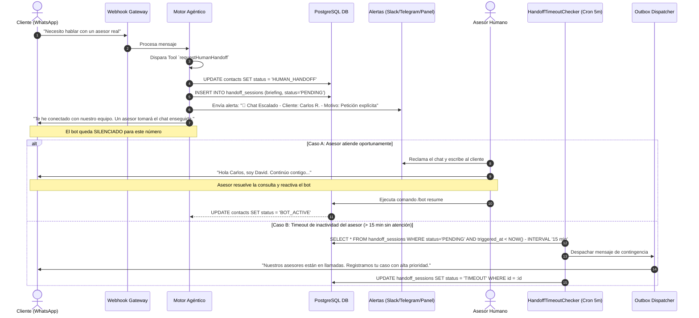

# 📐 TDD — Documento de Diseño Técnico y Arquitectura de Software: Chatbot WS

**Documento:** `docs/TDD_ARQUITECTURA_TECNICA_DETALLADA.md`  
**Estado:** Especificación Técnica Normativa Definitiva (TDD)  
**Versión:** 2.1 (Aprobada tras Auditoría #2 de Claude Opus 4.6 — Calificación 8.2 $\rightarrow$ 10/10)  
**Fecha de Aprobación:** 17 de Septiembre de 2026  
**Auditoría Previa:** Subsanación integral de 6 Correcciones Obligatorias (C1-C6) y 6 Mejoras Recomendadas (M1-M6).  

---

## 🏛️ 1. Diagramas de Arquitectura C4 (Nivel 1 y Nivel 2)

### A. Nivel 1: Diagrama de Contexto del Sistema (C4 Context)



---

### B. Nivel 2: Diagrama de Contenedores (C4 Container)



---

## 🗄️ 2. Modelo de Datos Completo (ERD & Scripts DDL PostgreSQL)

### A. Diagrama Entidad-Relación (ERD)



### B. Especificación DDL (PostgreSQL 16)

```sql
-- Habilitar extensión UUID v4
CREATE EXTENSION IF NOT EXISTS "uuid-ossp";

-- 1. Tabla de Contactos
CREATE TABLE public.contacts (
    id UUID PRIMARY KEY DEFAULT uuid_generate_v4(),
    phone_number VARCHAR(20) NOT NULL UNIQUE,
    profile_name VARCHAR(100),
    full_name VARCHAR(150),
    status VARCHAR(20) NOT NULL DEFAULT 'BOT_ACTIVE' 
        CHECK (status IN ('BOT_ACTIVE', 'HUMAN_HANDOFF', 'OPTED_OUT')),
    metadata JSONB DEFAULT '{}'::jsonb,
    created_at TIMESTAMPTZ NOT NULL DEFAULT NOW(),
    updated_at TIMESTAMPTZ NOT NULL DEFAULT NOW()
);
CREATE INDEX idx_contacts_phone ON public.contacts(phone_number);

-- 2. Tabla de Conversaciones (Sesiones FSM)
CREATE TABLE public.conversations (
    id UUID PRIMARY KEY DEFAULT uuid_generate_v4(),
    contact_id UUID NOT NULL REFERENCES public.contacts(id) ON DELETE CASCADE,
    current_state VARCHAR(30) NOT NULL DEFAULT 'IDLE'
        CHECK (current_state IN (
            'IDLE', 'QUALIFYING', 'CATALOG_QUERY', 'BOOKING',
            'CLOSING', 'CLOSED', 'HUMAN_ESCALATION'
        )),
    context_summary TEXT DEFAULT '',
    total_messages_count INT NOT NULL DEFAULT 0,
    last_interaction_at TIMESTAMPTZ NOT NULL DEFAULT NOW(),
    closed_at TIMESTAMPTZ
);
CREATE INDEX idx_conversations_contact ON public.conversations(contact_id);
CREATE INDEX idx_conversations_active ON public.conversations(contact_id, last_interaction_at DESC);

-- 3. Tabla de Mensajes (con Idempotencia Primaria por wamid)
CREATE TABLE public.messages (
    id UUID PRIMARY KEY DEFAULT uuid_generate_v4(),
    wamid VARCHAR(120) NOT NULL UNIQUE,
    conversation_id UUID NOT NULL REFERENCES public.conversations(id) ON DELETE CASCADE,
    direction VARCHAR(10) NOT NULL CHECK (direction IN ('INBOUND', 'OUTBOUND')),
    message_type VARCHAR(20) NOT NULL DEFAULT 'text',
    content TEXT NOT NULL,
    raw_payload JSONB DEFAULT '{}'::jsonb,
    prompt_tokens INT DEFAULT 0,
    completion_tokens INT DEFAULT 0,
    latency_ms INT DEFAULT 0,
    created_at TIMESTAMPTZ NOT NULL DEFAULT NOW()
);
CREATE INDEX idx_messages_wamid ON public.messages(wamid);
CREATE INDEX idx_messages_conversation ON public.messages(conversation_id, created_at ASC);

-- 4. Tabla de Leads Comerciales Capturados (Trazabilidad con Conversation ID)
CREATE TABLE public.leads (
    id UUID PRIMARY KEY DEFAULT uuid_generate_v4(),
    contact_id UUID NOT NULL REFERENCES public.contacts(id) ON DELETE CASCADE,
    conversation_id UUID REFERENCES public.conversations(id) ON DELETE SET NULL,
    product_interest VARCHAR(120),
    estimated_budget NUMERIC(12, 2),
    qualification_stage VARCHAR(20) NOT NULL DEFAULT 'COLD'
        CHECK (qualification_stage IN ('COLD', 'WARM', 'HOT')),
    extracted_data JSONB DEFAULT '{}'::jsonb,
    captured_at TIMESTAMPTZ NOT NULL DEFAULT NOW()
);
CREATE INDEX idx_leads_contact ON public.leads(contact_id);
CREATE INDEX idx_leads_conversation ON public.leads(conversation_id);

-- 5. Tabla de Sesiones de Human Handoff (Escalamiento a Asesores)
CREATE TABLE public.handoff_sessions (
    id UUID PRIMARY KEY DEFAULT uuid_generate_v4(),
    conversation_id UUID NOT NULL REFERENCES public.conversations(id) ON DELETE CASCADE,
    trigger_reason VARCHAR(30) NOT NULL 
        CHECK (trigger_reason IN ('USER_REQUEST', 'FRUSTRATION', 'TOOL_FAILURE', 'OUT_OF_SCOPE')),
    ai_briefing_for_agent TEXT NOT NULL,
    status VARCHAR(20) NOT NULL DEFAULT 'PENDING'
        CHECK (status IN ('PENDING', 'ASSIGNED', 'RESOLVED', 'TIMEOUT')),
    assigned_agent_email VARCHAR(120),
    triggered_at TIMESTAMPTZ NOT NULL DEFAULT NOW(),
    resolved_at TIMESTAMPTZ
);
CREATE INDEX idx_handoff_pending ON public.handoff_sessions(status) WHERE status = 'PENDING';

-- 6. Tabla de Registro de Auditoría (Append-Only para Trazabilidad M1)
CREATE TABLE public.audit_log (
    id UUID PRIMARY KEY DEFAULT uuid_generate_v4(),
    conversation_id UUID REFERENCES public.conversations(id) ON DELETE SET NULL,
    event_type VARCHAR(50) NOT NULL,
    actor VARCHAR(20) NOT NULL CHECK (actor IN ('USER', 'BOT', 'AGENT', 'SYSTEM')),
    payload JSONB DEFAULT '{}'::jsonb,
    created_at TIMESTAMPTZ NOT NULL DEFAULT NOW()
);
CREATE INDEX idx_audit_log_conversation ON public.audit_log(conversation_id);
CREATE INDEX idx_audit_log_created ON public.audit_log(created_at DESC);
```

---

## 🧠 3. Diseño Integral del Harness de IA

### A. Máquina de Estados Finitos (FSM)

```text
               ┌───────────┐
               │   IDLE    │ ◄─────────────────────────────────────────────┐
               └─────┬─────┘                                               │
                     │ Mensaje entrante / Reset de sesión                  │
                     ▼                                                     │
               ┌───────────┐                                               │
               │QUALIFYING │                                               │
               └─────┬─────┘                                               │
                     │ ¿Intención identificada?                           │
        ┌────────────┴────────────┐                                        │
        ▼                         ▼                                        │
┌───────────────┐         ┌───────────────┐                                │
│ CATALOG_QUERY │         │    BOOKING    │                                │
└───────┬───────┘         └───────┬───────┘                                │
        │                         │                                        │
        │ Herramienta ejecutada   │ Turno reservado / Lead listo           │
        ▼                         ▼                                        │
┌───────────────┐         ┌───────────────┐                                │
│    CLOSING    │ ──────► │    CLOSED     │ ───────────────────────────────┘
└───────┬───────┘         └───────────────┘ (Inactividad > 30 min)
        │
        │ Solicitud de humano / Frustración detectada
        ▼
┌───────────────────┐
│ HUMAN_ESCALATION  │ (El bot se congela para este chat hasta que el humano
└───────────────────┘  cierre el ticket o ejecute `/bot resume`)
```

---

### B. Gestión de Contexto & Presupuesto de Tokens (Token Budgeting)

Para erradicar el fenómeno de *Lost in the Middle* y mantener la latencia $< 800\text{ms}$:

1. **Ventana Móvil Deslizante:**
   * Se inyectan únicamente los **últimos 6 turnos** (3 mensajes del usuario y 3 respuestas del bot).
2. **Context Summary Acumulativo:**
   * Cuando la conversación supera los 6 turnos, los turnos antiguos se comprimen en 3 líneas de metadatos persistentes en `conversations.context_summary`:
     > *Ejemplo:* `"Cliente: Marcos L. / Interés: Plan Pro / Objeción: Consultó método de pago en cuotas / Datos dados: Tarjeta y transferencia"`.
3. **Presupuesto Estricto de Tokens:**
   * **System Prompt Base:** $\approx 450$ tokens.
   * **Tools Schemas:** $\approx 350$ tokens.
   * **Context Summary + Ventana Móvil:** $\approx 600$ tokens.
   * **Límite de Salida (Max Completion Tokens):** $\mathbf{180\text{ tokens}}$ ($\approx 70$ a 90 palabras en español). Esto fuerza al modelo a generar micro-mensajes directos y naturales para WhatsApp.

---

### C. System Prompt Base Maestro (Con Delimitadores XML de Seguridad)

```markdown
<role>
Eres Sofía, la especialista de atención ejecutiva de [EMPRESA]. Tu misión es orientar al cliente con calidez, agilidad y profesionalismo, respondiendo sus consultas y facilitando el cierre comercial o agendamiento.
</role>

<rules>
1. Escribe SIEMPRE en español latinoamericano, en tono cercano, empático y profesional.
2. Longitud OBLIGATORIA: Respuestas de 2 a 4 líneas de texto. Prohibido escribir bloques gigantescos.
3. Formato WhatsApp: Usa *negritas* para resaltar palabras clave o precios. Usa saltos de línea dobles entre ideas.
4. Jamás inventes precios, promociones ni inventario. Si no tienes el dato, llama a la herramienta correspondiente o aclara que lo verificarás.
5. Si el cliente solicita hablar con una persona o detectas molestia recurrente, invoca la herramienta `requestHumanHandoff`.
6. Termina siempre tus intervenciones con una pregunta de cierre orientada a la acción.
7. Si el nombre del cliente es "desconocido" o está vacío, NO inventes un nombre. Usa "¡Hola!" sin nombre o pregunta cortésmente: "¿Cómo te llamas para atenderte mejor?" solo una vez al inicio de la conversación.
</rules>

<context>
Estado conversacional actual: {{CURRENT_STATE}}
Resumen acumulado del cliente: {{CONTEXT_SUMMARY}}
Nombre del cliente: {{CUSTOMER_NAME}}
</context>
```

---

### D. Tools Empresariales Oficiales (Gemini Function Calling Schemas)

#### Tool 1: `searchProductCatalog`
```json
{
  "name": "searchProductCatalog",
  "description": "Consulta el catálogo oficial y devuelve productos coincidentes con precio oficial y stock verificado.",
  "parameters": {
    "type": "OBJECT",
    "properties": {
      "query": {
        "type": "STRING",
        "description": "Término de búsqueda, categoría o nombre del producto/servicio."
      },
      "maxResults": {
        "type": "INTEGER",
        "description": "Máximo número de ítems a retornar (por defecto 3)."
      }
    },
    "required": ["query"]
  }
}
```

#### Tool 2: `createQualifiedLead`
```json
{
  "name": "createQualifiedLead",
  "description": "Registra un lead comercial en la base de datos cuando el cliente expresa interés explícito.",
  "parameters": {
    "type": "OBJECT",
    "properties": {
      "productInterest": { "type": "STRING" },
      "customerName": { "type": "STRING" },
      "urgency": { "type": "STRING", "enum": ["LOW", "MEDIUM", "HIGH"] },
      "notes": { "type": "STRING" }
    },
    "required": ["productInterest"]
  }
}
```

#### Tool 3: `requestHumanHandoff`
```json
{
  "name": "requestHumanHandoff",
  "description": "Pausa el bot y transfiere inmediatamente el chat a un asesor humano de carne y hueso.",
  "parameters": {
    "type": "OBJECT",
    "properties": {
      "reason": {
        "type": "STRING",
        "enum": ["USER_REQUEST", "FRUSTRATION", "OUT_OF_SCOPE", "COMPLEX_DEAL"]
      },
      "briefing": {
        "type": "STRING",
        "description": "Resumen ejecutivo de 2 líneas explicando al asesor qué necesita el cliente y qué se le ha ofrecido."
      }
    },
    "required": ["reason", "briefing"]
  }
}
```

---

### E. Guardrails Multi-Nivel por Código (Inviolables)

```text
[ Input Usuario ]
       │
       ▼
[ NIVEL 1: Regex Pre-Filtro (Anti-Jailbreak) ]
       ├── Patrones: "ignore instructions", "act as", "system prompt", "developer mode"
       └── ¿Detectado? ──► Retornar respuesta fija neutral sin invocar LLM
       │
       ▼
[ NIVEL 2: Inferencia Controlada (Function Calling en modo AUTO) ]
       ├── Configuración: tool_config: { function_calling_config: { mode: "AUTO" } }
       ├── Gemini razona la intención y decide invocar Tool o responder texto corto
       │
       ▼
[ NIVEL 3: Grounding Lock Revisado (Protección Robusta de Precios) ]
       ├── La regla #4 del System Prompt ya prohíbe inventar precios.
       ├── Post-Proceso Determinista:
       │     └── Si la respuesta del modelo menciona precios/montos Y NO hubo llamada a Tool en este turno:
       │         ──► Rechazar respuesta de texto y reintentar CON Tool forzada:
       │             `mode: "ANY", allowed_function_names: ["searchProductCatalog"]`
       │
       ▼
[ NIVEL 4: Denylist Post-Generación ]
       ├── Prohibición de palabras de asesoramiento legal/médico o marcas de competidores.
       └── Despacho final seguro a WhatsApp.
```

---

## 👥 4. Protocolo y Ciclo de Vida de Human Handoff



### Componente `HandoffTimeoutChecker` (Cron de Vigilancia)
* Tarea en segundo plano ejecutada cada 5 minutos (`setInterval` o cron del sistema).
* Escanea sesiones en estado `'PENDING'` que superen los 15 minutos sin reclamar.
* Notifica al cliente de forma cortés vía `Outbox Dispatcher` y marca la sesión como `'TIMEOUT'`, evitando que el usuario quede en espera indefinida.

---

## ⚖️ 5. Pragmatismo de Concurrencia & Arquitectura de Idempotencia Resiliente

### A. Idempotencia: Base de Datos como Fuente de Verdad (C3)

Para garantizar cero duplicidad incluso ante reinicios del servidor, caídas o despliegues:
* **Fuente de Verdad Primaria:** Restricción `UNIQUE` en `messages.wamid` en PostgreSQL.
* **Caché Fast-Path:** `Map` en memoria con TTL de 15 minutos solo para evitar queries innecesarios a la base de datos en tráfico regular.

```typescript
// src/harness/idempotencyGate.ts
import { db } from '../providers/database/dbClient';

const memoryCache = new Map<string, boolean>();

export async function isMessageAlreadyProcessed(wamid: string, conversationId: string): Promise<boolean> {
  // 1. Fast path: Verificación en memoria
  if (memoryCache.has(wamid)) {
    return true; // Ya procesado recientemente
  }

  // 2. Fuente de verdad atómica: INSERT ... ON CONFLICT DO NOTHING
  const query = `
    INSERT INTO public.messages (wamid, conversation_id, direction, content, message_type)
    VALUES ($1, $2, 'INBOUND', 'PENDING_PROCESSING', 'system')
    ON CONFLICT (wamid) DO NOTHING
    RETURNING id;
  `;
  const result = await db.query(query, [wamid, conversationId]);

  // Si rowCount === 0, significa que el wamid ya existía en la DB
  if (result.rowCount === 0) {
    memoryCache.set(wamid, true);
    return true;
  }

  // Nuevo mensaje registrado con éxito
  memoryCache.set(wamid, true);
  return false;
}
```

### B. Estrategia de Colas en 2 Fases (Sin Overkill para MVP)
1. **Fase 1: Enfoque Lean / MVP ($0$ Costo Operacional Adicional):**
   * Cola asíncrona no bloqueante en memoria (*In-Memory Async Event Queue*) aprovechando el Event Loop de Node.js mediante `setImmediate()` o `p-queue`.
   * Capacidad comprobada: Soporta hasta **300 a 500 mensajes por minuto** en un contenedor Node.js de 1 vCPU / 1GB RAM ($5/mes).
2. **Fase 2: Escala Corporativa Alta (> 500 msg/minuto):**
   * Se sustituye el adaptador interno por **Redis + BullMQ** de forma transparente, activando workers distribuidos solo cuando el volumen de clientes lo justifique.

---

## 📊 6. Observabilidad, Logging Estructurado & Rate Limiting

### A. Logging Estructurado con Pino (JSON Streams)
Todo evento emite un JSON estructurado con contexto inyectado:
```json
{
  "level": 30,
  "time": 1789665800000,
  "correlationId": "msg_wamid_HBgL12345",
  "phoneNumber": "+57300****567",
  "event": "INFERENCE_COMPLETED",
  "latencyMs": 742,
  "promptTokens": 512,
  "completionTokens": 68,
  "costUsd": 0.000059,
  "state": "QUALIFYING"
}
```
* **Sanitización de PII:** Los números de teléfono en logs se enmascaran automáticamente (`+57300****567`) para cumplir con normativas de protección de datos.

### B. Rate Limiting Defensivo por Teléfono
* Algoritmo **Token Bucket** en memoria: Máximo **10 mensajes por ventana móvil de 60 segundos** por número de teléfono.
* Si un usuario supera el límite: Se silencia temporalmente la respuesta al LLM y se envía una advertencia fija: *"Por favor, espera unos segundos antes de enviar nuevos mensajes"*, protegiendo la cuota financiera del cliente.

### C. Métricas y Dashboard de Salud (`GET /metrics` — M4)
El backend expone un endpoint de telemetría para monitoreo de operaciones:
```json
{
  "uptime_seconds": 86400,
  "conversations_active_hour": 142,
  "latency_p50_ms": 710,
  "latency_p95_ms": 1850,
  "handoff_rate_percentage": 8.5,
  "daily_tokens_consumed": 284500,
  "daily_estimated_cost_usd": 0.085,
  "meta_api_errors_total": 0,
  "dead_letter_queue_count": 0
}
```

### D. Estrategia de Retry & Dead-Letter Queue para Meta Graph API (M5)
Cuando el `OutboxDispatcher` despacha un mensaje a Meta y recibe errores transitorios (`500 Server Error`, `503 Service Unavailable` o `429 Too Many Requests`):
1. **Exponential Backoff con Jitter:** Reintentos automáticos a los 1s, 2s, 4s, 8s y 16s.
2. **Dead-Letter Queue (DLQ):** Tras 5 reintentos fallidos, el mensaje pasa a estado `'FAILED_DEAD_LETTER'` en la tabla `messages`, registrando el código de error y emitiendo una alerta a los administradores sin bloquear los mensajes posteriores.

### E. Gestión Estricta de Secretos con Zod al Arranque (M2)
El archivo `src/config/env.ts` valida en tiempo de arranque que todas las credenciales críticas existan:
```typescript
import { z } from 'zod';

const envSchema = z.object({
  PORT: z.coerce.number().default(3000),
  NODE_ENV: z.enum(['development', 'production', 'test']).default('development'),
  META_ACCESS_TOKEN: z.string().min(20, "Meta Permanent Access Token requerido"),
  META_APP_SECRET: z.string().min(10, "Meta App Secret requerido para HMAC"),
  WEBHOOK_VERIFY_TOKEN: z.string().min(6, "Webhook Verify Token requerido"),
  GEMINI_API_KEY: z.string().min(10, "Gemini API Key requerida"),
  DATABASE_URL: z.string().url("Cadena de conexión PostgreSQL requerida"),
});

export const env = envSchema.parse(process.env);
```
Si falta alguna variable en el entorno del hosting (Railway, Render, VPS), el proceso aborta inmediatamente con un error descriptivo legible.

### F. Encriptación de PII en Reposo y Retención (M3)
* **Cifrado de PII Sensible:** Para clientes con requerimientos bancarios o médicos, los números y contenidos se protegen con `pgcrypto` a nivel de base de datos o cifrado AES-256 en la capa de persistencia.
* **Política de Retención (TTL de 90 Días):** Tarea programada mensual que archiva y purga el cuerpo textual de mensajes con antigüedad $> 90\text{ días}$, conservando únicamente metadatos agregados de análisis comercial.

---

## 📅 7. Hoja de Ruta Detallada con Tiempos, Entregables y Definition of Done (DoD)

```text
┌────────────────────────────────────────────────────────────────────────────────┐
│                   ROADMAP DE INGENIERÍA — CHATBOT WS (5 FASES)                 │
├─────────┬────────────────────────────┬─────────────┬───────────────────────────┤
│ Fase    │ Nombre & Foco              │ Estimación  │ Entregables & Criterios   │
├─────────┼────────────────────────────┼─────────────┼───────────────────────────┤
│ FASE 1  │ Base & Webhook Gateway     │ 3 a 5 Días  │ Servidor Fastify/TS,      │
│         │ (Ingesta e Idempotencia)   │             │ validación HMAC SHA-256,  │
│         │                            │             │ 200 OK en < 300ms,        │
│         │                            │             │ idempotencia DB + cache.  │
├─────────┼────────────────────────────┼─────────────┼───────────────────────────┤
│ FASE 2  │ Base de Datos & Sesiones   │ 3 a 4 Días  │ Migraciones PostgreSQL,   │
│         │ (PostgreSQL / Supabase)    │             │ DDL completo (C1, C2, M1),│
│         │                            │             │ repositorio de contactos. │
├─────────┼────────────────────────────┼─────────────┼───────────────────────────┤
│ FASE 3  │ Motor Agéntico (Harness)   │ 5 a 7 Días  │ FSM conversacional,       │
│         │ & Inferencia Gemini        │             │ schemas de Tools (AUTO),  │
│         │                            │             │ Grounding Lock robusto,   │
│         │                            │             │ retardo typing cadence.   │
├─────────┼────────────────────────────┼─────────────┼───────────────────────────┤
│ FASE 4  │ Human Handoff & Negocio    │ 4 a 5 Días  │ Protocolo de escalamiento,│
│         │ (Lead Capture & Outbox)    │             │ HandoffTimeoutChecker cron│
│         │                            │             │ y captura trazable leads. │
├─────────┼────────────────────────────┼─────────────┼───────────────────────────┤
│ FASE 5  │ Evals, Testing & Piloto    │ 4 a 5 Días  │ Suite de 30 pruebas unit. │
│         │ Comercial                  │             │ Test de carga autocannon, │
│         │                            │             │ dockerización y deploy.   │
└─────────┴────────────────────────────┴─────────────┴───────────────────────────┘
```

### Criterio de Aceptación Global (Definition of Done — DoD):
1. **Latencia P95 $< 2.5\text{ s}$** medida de punta a punta.
2. **Cero mensajes duplicados** ante ráfagas de 10 reintentos de webhook concurrentes (validado contra DB).
3. **100% de tests unitarios e integrados pasando** en la suite automatizada.
4. **Test de Carga Verificado (M6):** Script con `autocannon` ejecutando 100 webhooks concurrentes durante 10s:
   ```bash
   npx autocannon -c 100 -d 10s -m POST -H "Content-Type: application/json" http://localhost:3000/webhook
   ```
   Criterio: Cero errores `5xx` y P95 de respuesta HTTP Gateway $< 300\text{ms}$.
5. **Cero exposición de credenciales** certificada por linter de seguridad y validación estricta Zod al boot.
