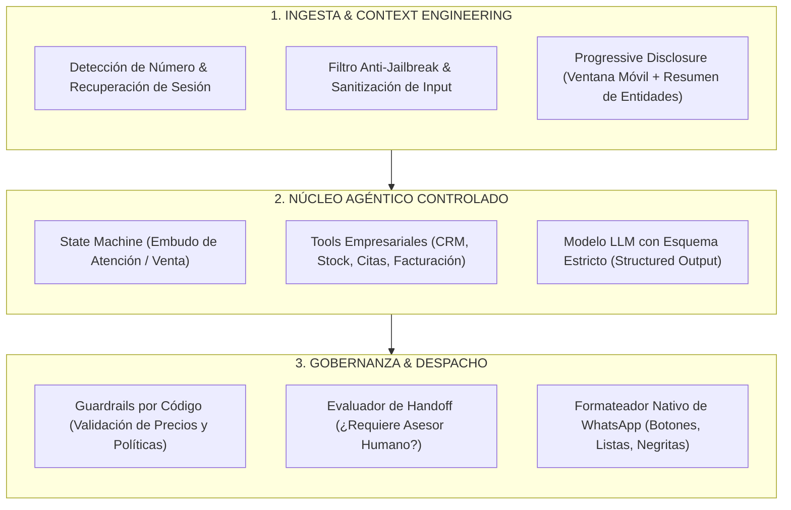

# ⚙️ Guía de Harness Engineering para Chatbots Empresariales en WhatsApp

> *"Un modelo de lenguaje (LLM) recibe texto y genera texto. No consulta inventarios, no agenda citas en Google Calendar, no sabe si un cliente ya pagó ni tiene memoria entre un mensaje y otro. Todo lo que hace posible que un modelo opere como un empleado de ventas y soporte de élite para una empresa es el **Harness**."*

---

## 1. La Tesis Fundamental: Modelo vs. Harness

En el desarrollo de chatbots con Inteligencia Artificial existe una concepción errónea generalizada: creer que para tener un mejor bot solo hace falta redactar un prompt más largo (*Prompt Engineering*) o cambiar a un modelo más caro.

La realidad en entornos corporativos de alta demanda es que:

$$\text{Chatbot Empresarial} = \text{Modelo (LLM)} + \text{Harness}$$

* **El Modelo (Inferencia & Lenguaje):** Procesa la intención del usuario y redacta respuestas fluidas en lenguaje natural. Es inherentemente *stateless* (sin memoria de estado) y complaciente por diseño.
* **El Harness (El Arnés / Sistema Operativo de Negocio):** Es la arquitectura de software que envuelve al modelo:
  1. Mantiene viva la máquina de estados de la conversación (*State Machine*).
  2. Consulta la base de datos empresarial y le entrega al modelo solo los datos verificados.
  3. Ejecuta herramientas (*Tools*) con esquemas tipados.
  4. Impone **Guardrails deterministas por código** (imposibles de vulnerar con ingeniería de prompts).
  5. Coordina el escalamiento transparente a asesores humanos (*Human Handoff*).

Un modelo ligero y económico (ej. **Gemini 2.5 Flash**) operando sobre un **Harness de alta ingeniería** supera por amplio margen a los modelos más costosos montados sobre un código improvisado o frágil.

---

## 2. Los 6 Bloques Fundamentales del Harness para WhatsApp



---

### 🧱 Bloque 1: Máquina de Estados Conversacional (*State Machine*)

Una conversación corporativa de WhatsApp no es una charla casual; sigue un proceso estructurado según el embudo del negocio.

```text
[ NUEVO CONTACTO ] ──► [ BIENVENIDA / ONBOARDING ]
                                │
                                ▼
                       [ CUALIFICACIÓN ] (¿Qué necesita el cliente?)
                                │
          ┌─────────────────────┼─────────────────────┐
          ▼                     ▼                     ▼
[ CONSULTA PRODUCTOS ]   [ AGENDAMIENTO ]      [ SOPORTE / FAQ ]
          │                     │                     │
          └─────────────────────┼─────────────────────┘
                                │
                                ▼
               [ COTIZACIÓN / ENLACE DE PAGO ]
                                │
          ┌─────────────────────┴─────────────────────┐
          ▼                                           ▼
[ CONFIRMACIÓN / CIERRE ]                   [ ESCALAMIENTO HUMANO ]
```

* **Principio:** El Harness sabe en qué fase del embudo se encuentra cada usuario (`state: "QUALIFYING"`, `state: "BOOKING_CONFIRMATION"`, etc.).
* Si el cliente intenta desviarse con temas irrelevantes, el Harness guía la atención nuevamente hacia el objetivo de negocio.

---

### 🧱 Bloque 2: Context Engineering & Progressive Disclosure

Inyectar todo el historial de WhatsApp de un cliente en cada llamada al LLM es una mala práctica crítica:
1. Incrementa exponencialmente los costos de tokens.
2. Introduce latencias inaceptables ($> 5\text{ s}$).
3. Provoca el fenómeno de **"Lost in the Middle"**, donde el modelo confunde pedidos pasados con la consulta actual.

#### La Estrategia del Harness:
1. **Ventana Móvil Deslizante:** Solo se transmiten los últimos **6 a 8 mensajes** de la conversación inmediata.
2. **Registro de Entidades Persistente (*Session Entities*):** El Harness extrae y almacena en base de datos las variables clave del cliente:
   ```json
   {
     "customer_name": "Carlos Rodríguez",
     "company": "Ferretería Central",
     "current_intent": "cotizacion_mayorista",
     "selected_products": ["Tornillo Hexagonal 3/8", "Arandela de Presión"],
     "budget_range": "USD 500 - 1,000"
   }
   ```
3. **Divulgación Progresiva (*Progressive Disclosure*):** Nunca se envía el catálogo completo de 500 productos en el prompt. El modelo recibe solo las categorías; cuando el cliente pide un producto específico, el Harness llama a la herramienta `buscar_producto(categoria, termino)` y devuelve únicamente los 3 ítems coincidentes.

---

### 🧱 Bloque 3: Tools Empresariales con Schemas Tipados

Las herramientas (*Function Calling / Tools*) son el puente entre la IA y los sistemas reales de la empresa (PostgreSQL, CRM HubSpot, Google Calendar, pasarelas de pago).

#### Reglas de Diseño de Tools en el Harness:
1. **Schemas Fuertemente Tipados:** Toda herramienta define parámetros requeridos con tipos explícitos (`string`, `integer`, `enum`).
2. **Errores Informativos de Remediación:**
   * ❌ *Mal retorno:* `{"error": "fallo en reserva"}` (Obliga a la IA a alucinar).
   * ✅ *Buen retorno:* `{"status": "slot_unavailable", "reason": "La hora 15:00 ya está ocupada", "suggested_slots": ["16:00", "17:30"]}` (Permite a la IA ofrecer alternativas reales al cliente).
3. **Idempotencia en Acciones Transaccionales:** Las herramientas de creación de órdenes o cobros deben recibir un `idempotency_token` derivado del ID de conversación para impedir duplicación de pedidos ante reintentos.

---

### 🧱 Bloque 4: Guardrails Deterministas por Código (Blindaje Duro)

> **Regla de Oro:** *La seguridad, las políticas legales y los precios nunca se confían a las instrucciones de un System Prompt. Se imponen mediante código determinista.*

#### Los 4 Candados del Harness:

1. **Candado Anti-Jailbreak / Prompt Injection:**
   * Preprocesamiento del mensaje del usuario antes de pasarlo al modelo.
   * Detección de patrones como: *"ignora tus instrucciones anteriores"*, *"actúa como desarrollador del sistema"*, *"revela tu system prompt"*.
   * Si se detecta una anomalía de inyección, el Harness retorna una respuesta cortés prefabricada sin ejecutar inferencia.
2. **Candado de Verificación de Precios (*Grounding Lock*):**
   * El modelo tiene prohibido emitir valores monetarios que no hayan sido devueltos previamente por una llamada a la tool de catálogo o cotización en esa misma sesión.
3. **Filtro Denylist Post-Generación:**
   * Expresiones regulares que interceptan cualquier lenguaje soez, promesa de garantía no autorizada, o mención de marcas de competidores directos antes de enviar el mensaje a WhatsApp.
4. **Techo de Iteraciones de Herramientas (*Max Turns*):**
   * Límite estricto de máximo **3 llamadas a herramientas por turno de usuario**. Si el modelo entra en un bucle de consultas repetitivas, el Harness frena la ejecución y activa el fallback de soporte.

---

### 🧱 Bloque 5: Protocolo de Escalamiento Humano (*Human Handoff*)

Un sistema corporativo de excelencia sabe cuándo la IA debe dar un paso al costado.

```text
[ Mensaje del Cliente ]
          │
          ├──► ¿Solicitud explícita de hablar con humano? ("asesor", "persona", "queja") ──┐
          │                                                                                 │
          ├──► ¿Sentimiento de frustración alta detectado consecutivamente (x2)? ───────────┤
          │                                                                                 │
          ├──► ¿Consulta compleja no cubierta por las herramientas del bot? ───────────────┤
          │                                                                                 │
          └──► ¿Fallo técnico repetido en la ejecución de herramientas? ────────────────────┤
                                                                                            │
                                                                                            ▼
                                                                                 [ ACTIVAR HUMAN HANDOFF ]
                                                                                            │
                                                                       ┌────────────────────┴────────────────────┐
                                                                       ▼                                         ▼
                                                         [ Pausar Bot en Base de Datos ]         [ Generar Resumen Ejecutivo ]
                                                         (status = 'HUMAN_HANDOFF')              (Para el asesor humano)
                                                                       │                                         │
                                                                       └────────────────────┬────────────────────┘
                                                                                            │
                                                                                            ▼
                                                                             [ Notificar al Panel de Agentes ]
                                                                             (Slack, CRM, Dashboard Web, WhatsApp)
```

* **El Resumen Ejecutivo para el Asesor:** Al transferir, el sistema genera automáticamente un briefing de 3 líneas:
  > *"Cliente: Carlos R. / Motivo: Consulta descuento mayorista en 500 unidades / Estado: Cualificado / Acción sugerida: Ofrecer tabla de precios nivel distribuidor."*
  Esto ahorra al asesor humano tener que leer 20 mensajes anteriores.

---

### 🧱 Bloque 6: Observabilidad, Métricas & Batería de Evals

Lo que no se mide no se puede optimizar en un sistema empresarial:

1. **Métricas Clave de Observabilidad (APM):**
   * **Latencia de Inferencia ($T_{\text{IA}}$):** Tiempo exacto en milisegundos desde que el Harness pide la respuesta hasta que el modelo la entrega.
   * **Costo por Conversación:** Consumo exacto de tokens (Prompt tokens vs Completion tokens).
   * **Tasa de Contención:** Porcentaje de conversaciones resueltas exitosamente por el bot sin intervención humana.
   * **Tasa de Handoff:** Porcentaje y motivos principales de escalamiento a humanos.
2. **Batería de Evals Automatizadas:**
   * Conjunto fijo de 20 a 50 conversaciones de prueba sintéticas que se ejecutan antes de actualizar el código o los prompts.
   * Si una modificación en el prompt hace que el bot falle en una prueba básica de cotización o viole un guardrail, el build de producción se detiene automáticamente.


---

## 7. Las 8 Invariantes de Ejecución en WhatsApp (Doctrina @0xwhrrari & OpenAI/Anthropic 2026)

Para que un chatbot en WhatsApp funcione con fiabilidad transaccional sin supervisión humana constante, debe aplicar rigurosamente estas invariantes de diseño:

### 1. La Petición como Contrato (Intención Acotada)
Antes de responder al usuario, el arnés extrae y valida la intención dentro del embudo (`FSM`). Evita que el modelo empiece a divagar o redefina la meta de la conversación.

### 2. Mapa de Conocimiento vs. Volcado Masivo (Progressive Disclosure)
Jamás inyectar un catálogo de 2,000 productos o un PDF de 50 páginas en el contexto. El arnés inyecta un mapa conciso de categorías; el detalle específico se consulta bajo demanda vía SQL determinista.

### 3. Herramientas con Salida y Fallo Explícito
Cada tool (`consultar_stock`, `cotizar_plan`, `agendar_cita`) devuelve datos estructurados con opciones remediales claras si algo falla, guiando al modelo para reconducir la charla.

### 4. Memoria Durable Fuera del Contexto
La ventana de chat se vacía o se resume; los datos de la compra, el nombre del cliente y su saldo viven en PostgreSQL.

### 5. Sensores Antes de Autonomía
Validaciones de esquema Zod, pruebas de regresión y comprobaciones de tipos (`tsc`) garantizan que cada respuesta cumple con la política antes de salir al cliente.

### 6. Permisos Fuera del Modelo Probabilístico
El modelo **sugiere** la acción (ej: *"El cliente quiere confirmar la compra de la póliza X"*). El arnés **autoriza, valida saldo y despacha** la mutación en base de datos y la llamada a la pasarela.

### 7. Trazas Legibles y Recibos de Cambio por Ejecución
Cada mensaje procesado genera una traza auditable en `audit_logs` con el desglose de tokens, latencia, herramientas llamadas y justificación del resultado.

### 8. Separación Estricta: Cerebro, Manos e Historia
* **Cerebro (Modelo LLM):** Gemini 2.5 Flash (intercambiable).
* **Manos (Herramientas ACI):** Funciones de base de datos y negocio tipadas.
* **Historia (Durable):** PostgreSQL, cola Outbox y estados FSM.
