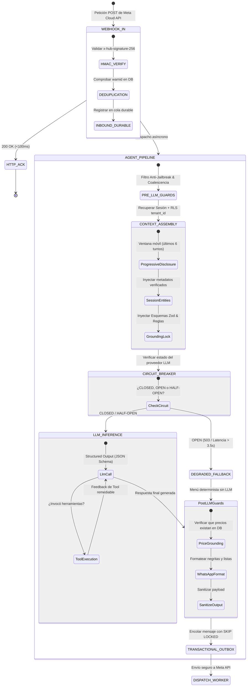
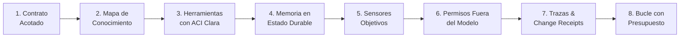
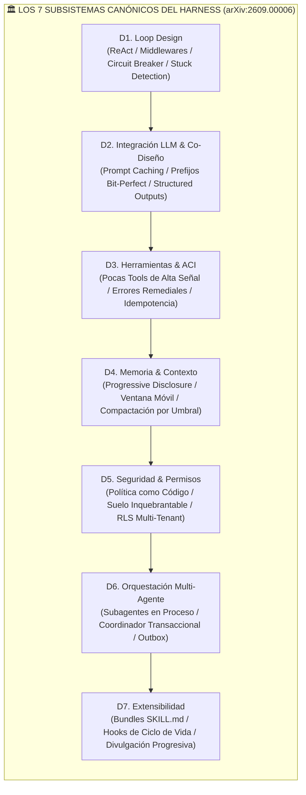
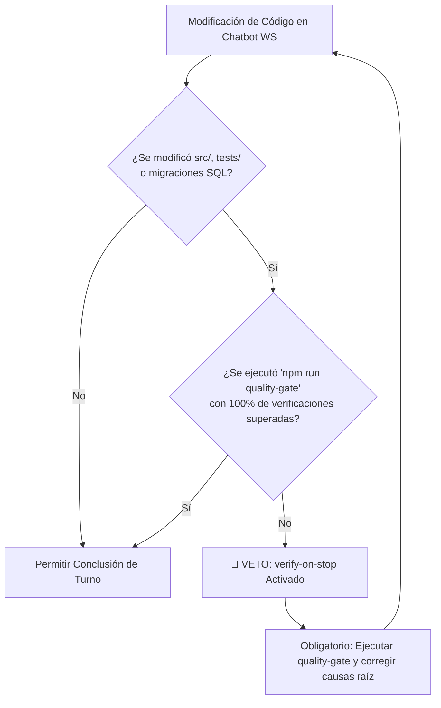

# 🧠 Chatbot WS — Guía de Harness Engineering: Arquitectura de Sistemas Agénticos en Producción

**Documento:** `docs/standards_and_harness/GUIA_HARNESS_ENGINEERING.md`  
**Estado:** Especificación Técnica Normativa de Sistemas Agénticos  
**Versión:** 3.5.0 (Certificación de Ingeniería Senior — arXiv:2609.00006, Síntesis @0xwhrrari, OpenAI Codex & Anthropic Architecture)  
**Fecha de Aprobación:** Octubre de 2026  
**Ámbito de Aplicación:** Chatbot WS (WhatsApp Daemon), TrasladosYa (Telegram Mobility Daemon), Outbox Processor, Inbound Durable Queue y Harness de Desarrollo  

---

> *"Un modelo de lenguaje recibe texto y devuelve texto. Eso es todo lo que hace. No procesa webhooks de Meta, no despacha mensajes a WhatsApp Cloud API, no asigna choferes en Telegram, no calcula matrices de tarifas en pesos ni impone Row-Level Security en PostgreSQL. Todo lo que no es el modelo, es el **Harness**."*

---

## 🏛️ 1. La Tesis Fundamental: Modelo vs. Harness en Mensajería Transaccional

Durante años el desarrollo de asistentes con IA sufrió una concepción simplista: creer que la calidad y estabilidad de un chatbot dependía exclusivamente de afinar prompts extensos (*Prompt Engineering*) o cambiar a un modelo más grande.

La investigación formal contemporánea en sistemas de producción (Anthropic, DeepMind, el estudio empírico de 11 arneses industriales en **arXiv:2609.00006** y las contribuciones de **@0xwhrrari**) ha formalizado la tesis matemática opuesta:

$$\text{Chatbot Transaccional de Alta Concurrencia} = \text{Modelo de Lenguaje (LLM)} + \text{Harness de Ingeniería}$$

* **El Modelo (Inferencia & Decodificación de Intención):** Es únicamente el motor de razonamiento y redacción. Es intrínsecamente *stateless* (sin memoria de estado), probabilístico y propenso a alucinaciones de precios si no está mecánicamente acotado.
* **El Harness (El Arnés / Sistema Operativo de Negocio):** Es la totalidad del entorno operativo determinista que envuelve al modelo:
  1. Qué información puede ver y consultar.
  2. Qué herramientas puede tocar y con qué límites de autorización.
  3. Qué estado persiste entre turnos y sesiones.
  4. Qué cuenta como evidencia válida antes de actuar.
  5. Cuándo debe detenerse, reintentar o escalar a un humano (*Human Handoff*).

### 📊 Distinción Canónica entre Disciplinas

| Disciplina | Qué se modifica | Alcance Operativo | Resultado Típico en Producción |
| :--- | :--- | :--- | :--- |
| **Prompt Engineering** | La instrucción redactada | Una sola llamada puntual | Mejor redacción en una respuesta de chat |
| **Context Engineering** | Qué ve el modelo en cada paso | Una sola ventana de contexto | Mejor contexto inmediato y reducción de ruido |
| **Harness Engineering** | El entorno completo de ejecución | Todo el ciclo de vida del agente | **Agente que ejecuta trabajo real transaccional de forma fiable** |

> [!IMPORTANT]
> **Principio Operativo Dominante (OpenAI y Anthropic coinciden):**  
> **«Los humanos dirigen. Los agentes ejecutan.»**  
> Cuando un agente falla de forma repetida, la respuesta técnica correcta **jamás es "intenta más fuerte" ni cambiar el modelo por uno más grande**. La pregunta rigurosa de ingeniería es:  
> *«¿Qué capacidad, contexto, herramienta o restricción falta en el entorno, y cómo la hacemos legible y mecánicamente exigible?»*

> [!WARNING]
> **El Peligro del Entorno Poco Definido (*Underspecified*):**  
> El problema más común en los sistemas con IA no es la falta de inteligencia del modelo, sino un entorno de ejecución poco definido. Si las condiciones son ambiguas o carecen de sensores objetivos, **un modelo más potente no hará el sistema fiable; solo hará que el fallo sea más costoso e impredecible**.

$$\text{SNR}_{\text{context}} = \frac{\text{Tokens de Intención, Catálogo y Estado Táctico}}{\text{Tokens Totales Inyectados en la Ventana de Atención}}$$

---

## 🔄 2. Ciclo de Vida ReAct del Chatbot Transaccional

El motor agéntico de Chatbot WS y TrasladosYa no ejecuta inferencias acopladas a la petición HTTP de entrada. Opera bajo una arquitectura desacoplada y reactiva que garantiza respuesta a Meta en `<100ms`:



---

## 🏢 3. Casos de Estudio Empíricos de Referencia (2025–2026)

### A. OpenAI — Experimento Codex (Febrero 2026)
Un equipo pequeño (comenzó con 3 ingenieros, creció a 7) construyó y desplegó un producto corporativo interno con **0 líneas de código escritas a mano**:
* **Métricas:** $\sim 1\text{ millón de líneas de código}$, $\sim 1.500\text{ Pull Requests}$, tiempo de desarrollo estimado en $1/10$ del esfuerzo manual tradicional.
* **Throughput:** $3.5\text{ PRs/ingeniero/día}$ (aumentando conforme el arnés maduraba).
* **Hallazgo Clave de Harness:** Los humanos no programaban lógica puntual; diseñaban el entorno, especificaban la intención en contratos y construían los bucles de retroalimentación (*feedback loops*). Los agentes escribían, testeaban, revisaban y mergeaban.
* **El Repositorio como Sistema de Registro:** El repositorio Git se convirtió en la única fuente de verdad, con un `AGENTS.md` corto y quirúrgico operando como **mapa conceptual de navegación**, no como una enciclopedia exhaustiva. El progreso inicial era lento únicamente cuando el entorno estaba *underspecified*.

### B. Anthropic — Agentes de Larga Duración y Managed Agents (Nov 2025 – Mar 2026)
* **El Problema Diagnosticado:** Pérdida de contexto entre sesiones consecutivas, tendencia al *one-shot* descuidado, declaración prematura de "terminado" y autoevaluación leniente por parte del propio modelo generador.
* **Solución Arquitectónica Inicial:** Agente inicializador (*Initializer*) + Agente de código (*Coding Agent*), apoyados en artefactos estructurados en disco (`feature_list.json`, git, `init.sh`).
* **Arquitectura de Tres Agentes (*Planner + Generator + Evaluator*):** Inspirada en redes antagónicas (GANs). El **Evaluador es completamente independiente** y verifica la salida del Generador utilizando herramientas de interacción real (tests automatizados, headless browser, validadores AST).
* **Managed Agents (Separación Tripartita del Runtime):**
  1. `Session`: Registro *append-only* inmutable (fuente única de verdad histórica).
  2. `Harness`: Bucle *stateless* reanudable que orquesta el control sin acoplarse al estado en memoria.
  3. `Sandbox`: Entorno de ejecución aislado con herramientas acotadas ("las manos") donde las credenciales maestras **jamás ingresan**.

---

## 🚫 4. La Doctrina de las Dos Ausencias (The Twin Absences)

Uno de los hallazgos empíricos más contundentes de **arXiv:2609.00006** tras auditar más de 4 millones de líneas de código en 11 arneses de producción (*Claude Code, Codex CLI, Mistral Vibe, OpenHands, Aider, Hermes, etc.*) es la ausencia total de dos patrones ampliamente promocionados en el mercado:

```
┌─────────────────────────────────────────────────────────────────────────────┐
│                 LAS DOS GRANDES AUSENCIAS DE LA INDUSTRIA                  │
├──────────────────────────────────────┬──────────────────────────────────────┤
│ 1. CERO FRAMEWORKS AGÉNTICOS         │ 2. CERO RAG VECTORIAL SOBRE CÓDIGO   │
│    (LangChain, CrewAI, AutoGen)      │    O CATÁLOGOS ESTRUCTURADOS         │
├──────────────────────────────────────┼──────────────────────────────────────┤
│ Todos los arneses de producción usan │ Todos los arneses usan herramientas  │
│ bucles artesanales en primitivas     │ deterministas: consultas SQL con     │
│ nativas del lenguaje (Node/Fastify,  │ índices, esquemas Zod, AST y         │
│ asyncio, Tokio).                     │ cálculo relacional exacto.           │
└──────────────────────────────────────┴──────────────────────────────────────┘
```

### ¿Por qué Cero Frameworks Agénticos en Chatbot WS?
1. **Transparencia y Depuración Determinista:** En mensajería empresarial con un SLA de respuesta `<1.5s`, una capa intermedia opaca que inyecta prompts invisibles, secuestra el control de errores o agrega retrasos de 500ms es inaceptable.
2. **Control Absoluto del Event Loop:** Node.js es single-threaded. Cualquier framework que bloquee el ciclo con serializaciones innecesarias o abstracciones pesadas degrada la concurrencia masiva de webhooks.
3. **El Arnés ES el Framework:** La combinación de Fastify + repositorios PostgreSQL + Zod + cliente HTTP genérico para APIs compatibles con OpenAI constituye un arnés con cero dependencias superfluas.

### ¿Por qué Cero RAG Vectorial para Catálogos y Tarifas?
1. **Falta de Precisión y Alucinaciones de Similitud Coseno:** La búsqueda vectorial es probabilística. Si un usuario pide *"viaje de San Cristóbal a Cúcuta"*, un vector RAG puede devolver la tarifa de *"Cúcuta a Bucaramanga"* por cercanía semántica. En aplicaciones comerciales y financieras, esto destruye la confianza y genera pérdidas económicas.
2. **Obsolescencia Inmediata (*Stale Embeddings*):** Precios, inventarios y disponibilidad de choferes cambian segundo a segundo; re-indexar vectores en caliente introduce latencia y desincronización.
3. **Superioridad de Herramientas Deterministas:** Una consulta SQL indexada (`SELECT price_amount_cents FROM mobility_fare_matrix WHERE origin_zone_id = $1 AND destination_zone_id = $2`) responde en `<3ms`, con exactitud matemática bit-perfect y **\$0 de costo en tokens**.

---

## 🛠️ 5. Las 8 Funciones Canónicas de un Harness de Producción (@0xwhrrari & Estándares de Industria)

Todo arnés robusto en producción debe satisfacer de manera explícita estas 8 funciones operativas:



### 1. Convertir la Petición en un Contrato (Intención Acotada)
Antes de que el agente actúe, la solicitud se transforma en un objeto estructurado, acotado y verificable. Esto previene que el modelo redefina silenciosamente el objetivo y declare victoria sobre una tarea distinta o simplificada.

### 2. Dar al Agente un Mapa de Conocimiento (Progressive Disclosure)
Proporcionar una guía raíz concisa (`AGENTS.md`) que oriente al modelo hacia dónde consultar información especializada. El detalle profundo se carga bajo demanda. Un manual gigantesco satura la ventana de contexto; **un mapa preserva el contexto y eleva la relación señal-ruido**.

### 3. Exponer las Herramientas Correctas en el Entorno Correcto
Cada herramienta (*Tool*) debe contar con:
* Propósito atómico único y claro.
* Salida estructurada y predecible.
* Estado de fallo explícito y remedial.
* Límite estricto de permisos.  
Las herramientas bien concebidas disipan la ambigüedad antes de que el modelo comience a razonar.

### 4. Externalizar la Memoria en Estado Durable
**La conversación no es el sistema de registro.**  
Decisiones, artefactos, transacciones, cotizaciones y estados de la máquina FSM residen en PostgreSQL (`conversations`, `contacts`, `messages`, `outbox_messages`) para sobrevivir a reinicios del servidor, fallos de red y transferencias a operadores humanos (*Human Handoff*).

### 5. Añadir Sensores Antes de Añadir Autonomía
**El agente no puede corregir lo que no puede observar.**  
Suites de pruebas (`vitest`), validadores de esquema Zod, linters de tipos (`tsc`), métricas de latencia y logs estructurados convierten la calidad en evidencia objetiva:
$$\text{El Modelo Genera el Artefacto} \longrightarrow \text{El Entorno Produce la Evidencia} \longrightarrow \text{El Harness Decide si Continúa}$$

### 6. Aplicar Permisos Fuera del Modelo
El modelo de IA solo puede **recomendar o solicitar** una acción. El arnés determinista es quien **autoriza y ejecuta** dicha acción. Esto es crítico en operaciones monetarias, irreversibles o que interactúan con terceros (como Meta Graph API o pagos). Jamás se pide al mismo sistema probabilístico que conciba el plan, auto-apruebe el riesgo y ejecute la mutación.

### 7. Registrar Trazas Legibles y Recibos de Cambio (*Change Receipts*)
Cada interacción debe dejar un registro auditable (`audit_logs`, `inbound_events`). Se almacena no solo el resultado final, sino **el recibo compacto de cómo se produjo**, permitiendo depuración forense, comparación entre modelos y detección inmediata de regresiones.

### 8. Bucle de Control con Presupuesto y Escalada
Un bucle productivo posee:
* Evidencia objetiva recolectada por sensores.
* Reintentos acotados (máximo 3 llamadas de herramientas por turno).
* Presupuesto de tiempo y tokens (Rate Limiting dual RPM/TPM).
* Camino de escalada determinista a soporte humano cuando se detecta un bloqueo (*Stuck Detection*).

---

## 🧱 6. Guardrails Mecánicos y Patrones de Diseño Avanzados

### A. Instrucciones como Infraestructura (Codificación Doble)
Toda regla crítica de negocio debe codificarse **dos veces**:
1. **Como guía comprensible** para el modelo en su prompt de sistema o mapa de contexto.
2. **Como chequeo mecánico e infranqueable** en el código del servidor (middleware Zod, test estructural, trigger SQL, política RLS).  
*De este modo, cualquier fallo pasado registrado en el catálogo de auto-aprendizaje se convierte en una restricción permanente del sistema que el agente no puede vulnerar.*

### B. Separar Cerebro, Manos e Historia
* **Cerebro $\longrightarrow$ Modelo (LLM):** Motor de lenguaje intercambiable (Gemini 2.5 Flash, Claude 3.5, etc.).
* **Manos $\longrightarrow$ Herramientas deterministas (ACI):** Funciones tipadas con esquemas Zod y efectos colaterales controlados.
* **Historia $\longrightarrow$ Estado durable + Trazas:** Tablas relacionales PostgreSQL y colas duraderas.  
*Esta separación permite reemplazar el modelo de IA ante cambios de precios o proveedores sin alterar las herramientas ni las políticas de seguridad del negocio.*

### C. Invariantes en Lugar de Micromanagement
Definir los límites arquitectónicos inflexibles (*Suelo Inquebrantable*) y conceder autonomía al modelo dentro de esa caja de seguridad.

### D. Evaluación Separada (Evaluator Independiente)
El agente que redacta o genera una acción no debe ser el único que evalúe si cumple los estándares. Validadores deterministas externos y filtros post-LLM actúan como jueces imparciales.

### E. Default-Fail (Fallo por Defecto)
Todos los criterios de validación inician en falso (`false`). Solo se conmutan a verdadero (`true`) cuando el arnés recibe evidencia empírica verificable.

### F. Sandboxing y Blast Radius
Aislamiento de procesos, ejecución con privilegios mínimos en el sistema operativo y confinamiento de credenciales maestras fuera del entorno visible por el modelo.

### G. Limpieza Continua (*Continuous Cleanup*)
Servicios en segundo plano (`retentionService.ts`) que auditan la persistencia, purgan eventos procesados (`DONE`) y evitan la acumulación de entropía o deuda técnica.

---

## 🔬 7. Los 7 Subsistemas Canónicos del Arnés (arXiv:2609.00006)



### D1: Diseño del Loop del Agente (*Agent Loop Design*)
* **Patrón de Producción:** Iteración acción-observación basada en ReAct, complementada por middlewares componibles de Fastify.
* **Técnica Anti-Bloqueo (*Stuck Detection*):** Detección determinista barata basada en hash SHA-256 de `(tool_name, sorted_args_json)`. Si el modelo intenta ejecutar la misma herramienta con idénticos argumentos consecutivamente, el arnés interviene abortando el bucle y activando el escalamiento a asesor humano (`HUMAN_HANDOFF`).
* **Techo de Pasos (*Step Budget*):** Límite estricto de máximo **3 llamadas a herramientas por turno de usuario** para prevenir agotamiento de cuotas y demoras en el webhook.

### D2: Integración LLM y Co-Diseño Modelo–Arnés
* **Optimización de Caché de Prompt:** Separación estricta entre el prefijo estático inmutable (políticas de empresa, reglas de atención, esquemas de tools Zod) y el sufijo dinámico volátil (últimos turnos del usuario).
* **Prefijos Bit-Perfect:** Garantizar que los primeros 1,500 tokens del contexto sean byte-a-byte idénticos entre conversaciones del mismo tenant, alcanzando un **Prompt Cache Hit Rate superior al 80%** en el proveedor LLM y reduciendo la latencia de inferencia a `<600ms`.
* **Structured Outputs por Contrato:** Ninguna decisión de negocio se parsea con expresiones regulares sobre texto libre; se requiere JSON Schema nativo en la API del proveedor respaldado por esquemas Zod estrictos.

### D3: Sistemas de Herramientas y Acciones (*ACI - Agent-Computer Interface*)
* **Doctrina de Pocas Herramientas Pensadas (*Few Thoughtful Tools*):** Rechazo a exponer tablas directas de PostgreSQL como tools. Consolidar herramientas en operaciones atómicas de alta semántica: `quote_trip`, `confirm_booking`, `search_catalog`, `escalate_to_human`.
* **Errores Informativos y Remediales:** Una tool nunca retorna un error genérico (`{"status": "error"}`). Debe incluir la causa y opciones válidas para que el modelo sepa cómo reparar el camino conversacional.
* **Idempotencia Transaccional:** Cada herramienta de mutación exige un token de idempotencia derivado de `wamid` o `trip_id`.

### D4: Gestión de Memoria y Contexto
* **Progressive Disclosure:** Nunca inyectar catálogos completos en el prompt. El modelo recibe categorías; solo cuando el cliente solicita un producto o ruta particular, el arnés entrega los 3 resultados pertinentes.
* **Ventana Móvil Deslizante:** Solo se transmiten los últimos **6 a 8 mensajes** de la conversación inmediata, complementados por el registro estructurado de entidades persistentes (`session_entities`).
* **Compactación por Umbral (*Threshold Compaction*):** Si la conversación supera los 20 mensajes, el arnés sintetiza los mensajes centrales en un resumen de estado (`context_summary`), **manteniendo intactas las directrices raíz del sistema y el 30% más reciente de mensajes en formato verbatim**.

### D5: Modelos de Seguridad y Permisos
* **El Suelo Inquebrantable (*Unbreakable Floor*):** Reglas deterministas codificadas a nivel de servidor que **sobreviven incluso ante instrucciones adversarias o jailbreaks del usuario**:
  1. *Cero Secretos:* Prohibición de credenciales en código rastreado por git.
  2. *Aislamiento Multi-Tenant:* Todo query SQL sin `WHERE business_id = $1` es rechazado por el pool de base de datos.
  3. *Grounding Lock en Precios:* El LLM no puede emitir montos monetarios que no provengan de la tabla de precios oficial.
* **Políticas como Código (*Policy-as-Code*):** Filtros pre-LLM que rechazan ataques de inyección antes de invocar la API externa.

### D6: Orquestación Multi-Agente
* **Principio de Simplicidad:** Agente principal único para interacción con el cliente en WhatsApp.
* **Subagentes en Proceso & Desacople Transaccional:** En TrasladosYa, el despacho de viajes a choferes de Telegram opera como un daemon en proceso independiente (`mobilityEngine`), coordinado con el daemon de WhatsApp a través de la tabla relacional `trips` y la cola `outbox` en PostgreSQL, evitando microservicios distribuidos innecesarios.

### D7: Mecanismos de Extensibilidad
* **Predominio de `SKILL.md` sobre MCP:** Adopción de habilidades procedimentales (`docs/standards_and_harness/GUIA_SKILLS_Y_WORKFLOWS_AGENTICOS.md`) como estándar operativo para tareas de ingeniería asistida por IA.
* **Hooks de Ciclo de Vida:** Puntos de extensión componibles (`pre_inbound`, `post_llm_verification`, `pre_outbox_dispatch`).

---

## 🛡️ 8. Stop-Guards y Verificación a la Salida (Verification-on-Stop)



### Reglas del Guardrail `verify-on-stop`:
1. Si un agente o desarrollador modifica código en `src/`, `tests/` o `scripts/`, **no puede declarar la tarea como terminada** sin antes haber ejecutado `npm run quality-gate`.
2. El arnés intercepta la intención de parada si existen fallos de TypeScript, secretos expuestos, regresiones de tests o esquemas `.env` rotos.

---

## 🗺️ 9. Mapeo del Harness Engineering a los Módulos de Chatbot WS & TrasladosYa

| Componente Canónico (arXiv:2609.00006 & @0xwhrrari) | Módulo en Chatbot WS | Módulo en TrasladosYa | Responsabilidad Técnica |
|---|---|---|---|
| **D1: Loop & Ingesta** | `src/routes/webhook.ts` | `src/routes/webhook.ts` | Verificación HMAC SHA-256, deduplicación `wamid` y 200 OK `<100ms`. |
| **D1: Circuit Breaker** | `src/services/circuitBreaker.ts` | `src/services/circuitBreaker.ts` | Detección de fallos del proveedor LLM, fallback a menús estructurados. |
| **D2: LLM & Caching** | `src/providers/llm/llmClient.ts` | `src/providers/llm/llmClient.ts` | Cliente LLM genérico (API compatible OpenAI) con tools, timeout y rate limiting. |
| **D3: Tools Deterministas** | `src/services/agentEngine.ts` | `src/services/mobilityEngine.ts` | Cotización de viajes, matriz de zonas fijas, reserva de turnos. |
| **D4: Context & Memoria** | `src/services/contextManager.ts` | `src/services/contextManager.ts` | Ventana móvil, compresión de turnos y Progressive Disclosure. |
| **D5: Guardrails Duros** | `src/services/guardrails.ts` | `src/services/guardrails.ts` | Grounding Lock en tarifas, filtro anti-jailbreak y denylist. |
| **D5: Aislamiento Tenant** | `src/database/repositories/` | `src/database/repositories/` | Filtro forzoso por `business_id` y RLS en todas las tablas. |
| **D6: Outbox & Despacho** | `src/database/repositories/outboxRepository.ts` | `src/database/repositories/outboxRepository.ts` | Cola durable con `FOR UPDATE SKIP LOCKED` y reintentos exponenciales. |
| **D6: Multi-Canal Mobility** | *N/A (WhatsApp puro)* | `src/services/telegramBotClient.ts` | Despacho a canal de choferes y reclamo atómico de servicios. |
| **D7: Skills de Ingeniería** | `docs/standards_and_harness/` | `docs/standards_and_harness/` | Procedimientos `GUIA_SKILLS_Y_WORKFLOWS_AGENTICOS.md`. |

---

## 📋 10. Las 18 Recomendaciones de Diseño de Arnés Adaptadas

| # | Recomendación Canónica | Implementación Concreta en Chatbot WS & TrasladosYa |
|---|---|---|
| **R1** | Iniciar con bucle lineal simple; escalar a middlewares ante políticas ortogonales. | Pipeline desacoplado Fastify: Ingesta $\rightarrow$ Contexto $\rightarrow$ LLM $\rightarrow$ Guardrails $\rightarrow$ Outbox. |
| **R2** | Abstracción de proveedor sin SDK propietario. | Cliente HTTP genérico (API compatible OpenAI) con Circuit Breaker determinista ante caídas del proveedor. |
| **R3** | Comenzar con herramientas mínimas y ampliar solo ante fallos comprobados. | Catálogo acotado de tools (`get_zone_fare`, `request_ride`, `cancel_ride`, `escalate_human`). |
| **R4** | Carga diferida de herramientas si el catálogo excede de 15. | Exposición contextual de herramientas según el estado de la FSM conversacional. |
| **R5** | Edición contextual exacta por subcadenas únicas; nunca por números de línea. | Uso estricto de herramientas de edición contextual para evitar desalineación de código. |
| **R6** | Descubrimiento jerárquico de Markdown (`AGENTS.md`, `CLAUDE.md`, `GEMINI.md`). | Directrices normativas en raíz (`AGENTS.md`) cargadas en el system prompt de desarrollo. |
| **R7** | Compactación por umbral con cola reciente del 30% intacta. | `contextManager.ts` mantiene reglas estáticas y últimos turnos en formato verbatim. |
| **R8** | Cero RAG vectorial sobre lógica de negocio; usar herramientas deterministas. | Tablas relacionales PostgreSQL indexadas para catálogo de productos y matriz de tarifas. |
| **R9** | Arquitectura de 3 modos de aprobación (PLAN / DEFAULT / YOLO). | Guardrails de entorno: desarrollo local vs staging vs producción con compuertas automáticas. |
| **R10** | Aislamiento a nivel de sistema operativo para tareas críticas. | Servidor ejecutado bajo usuario sin privilegios en VPS con Cloudflare Tunnel Zero Trust. |
| **R11** | Políticas de seguridad declarativas como código con suelo inquebrantable. | Guardrails server-side (`guardrails.ts`) y validación Zod previa a base de datos. |
| **R12** | Mantener agente único hasta que exista necesidad de búsqueda paralela. | Agente conversacional central asistido por workers asíncronos en segundo plano. |
| **R13** | Adoptar protocolo estándar para hosting; subagentes en proceso. | Daemon de Telegram y Daemon de WhatsApp corriendo en el mismo proceso Node.js. |
| **R14** | Priorizar `SKILL.md` para flujos de ingeniería sobre MCP. | Procedimientos de desarrollo guiados por `GUIA_SKILLS_Y_WORKFLOWS_AGENTICOS.md`. |
| **R15** | Evitar frameworks agénticos pesados (LangChain/CrewAI) en el runtime. | Cero frameworks de terceros en `package.json`; pureza absoluta de librerías nativas. |
| **R16** | No construir capas de embeddings para precios ni catálogos. | Consultas SQL relacionales exactas para cálculo de tarifas en pesos y dólares. |
| **R17** | No envolver APIs externas 1 a 1 como herramientas independientes. | Consolidar endpoints en operaciones de negocio de alto nivel (`process_booking`). |
| **R18** | Detección barata de bloqueos (hashing SHA-256 de llamadas repetidas). | Stuck Detection en `agentEngine.ts` que interrumpe bucles y transiciona a soporte humano. |

---

## 🎯 11. Checklist Maestro de Validación Previa a Producción (10 Invariantes)

Antes de promover código o activar un nuevo cliente en producción, todo el sistema debe responder afirmativamente a estas 10 preguntas:

- [ ] **1. Contrato Acotado:** ¿Existe un contrato o criterio de "done" claro, específico y verificable antes de iniciar la ejecución?
- [ ] **2. Mapa de Conocimiento:** ¿El agente dispone de una guía raíz ágil (`AGENTS.md`) en lugar de un volcado masivo y desestructurado de documentación?
- [ ] **3. Herramientas Precisas:** ¿Cada herramienta expone propósito unívoco, esquema Zod estricto, salida predecible y estado de fallo explícito?
- [ ] **4. Memoria Durable:** ¿La memoria conversacional, transacciones y entidades residen en PostgreSQL fuera de la ventana de contexto del LLM?
- [ ] **5. Sensores de Evidencia:** ¿Existen sensores objetivos (tests unitarios, comprobaciones de tipos, esquemas de base de datos) antes de permitir autonomía?
- [ ] **6. Autorización Fuera del Modelo:** ¿Los permisos de mutación, el despacho a Meta y el acceso a claves de API residen fuera del modelo probabilístico?
- [ ] **7. Trazabilidad & Recibos:** ¿Cada ejecución genera logs estructurados (`Pino`) y recibos legibles del proceso (`audit_logs`) para auditoría forense?
- [ ] **8. Bucle con Límites:** ¿El bucle ReAct cuenta con presupuesto estricto de pasos (máximo 3 tools/turno), rate limiting dual y escalada humana?
- [ ] **9. Reglas como Infraestructura:** ¿Las políticas críticas de negocio están blindadas mediante chequeos mecánicos por código además de prompts en texto?
- [ ] **10. Repositorio como Registro:** ¿El repositorio Git y la base de datos relacional constituyen la fuente única de verdad del sistema?

> [!CAUTION]
> Si varias respuestas a este checklist son **«NO»**, emplear un modelo más inteligente no resolverá la inestabilidad del sistema: **únicamente hará que el fallo sea más costoso de reparar**.

---

## 🏆 12. Principio Final: La Ventana Acumulativa del Harness

> **El modelo de lenguaje puede sustituirse periódicamente conforme evolucione el mercado. El arnés (herramientas deterministas, persistencia de estado, políticas de seguridad como código, tests automatizados y gestión de permisos) es el verdadero activo acumulativo de la empresa.**  
>
> **La ventaja competitiva durable no radica en el prompt del momento, sino en la solidez del arnés que hace que la inteligencia del modelo sea reproducible, predecible y segura a escala industrial.**

---

## 📚 13. Referencias Normativas

1. **Barbaste, P., Darrigol, T., Vu, G., & Wiltberger, T. (2026).** *Harness Engineering: Anatomy, Architecture, and Evolution of Coding Agents — A Source-Code Study of Eleven Systems.* arXiv preprint arXiv:2609.00006v1.
2. **@0xwhrrari (2026).** *Harness Engineering: Definición, Funciones de Producción y Patrones Fundamentales para Agentes Fiables.*
3. **OpenAI Applied Research (2026).** *The Codex Experiment: Zero Hand-written Code at Scale — Infrastructure, Feedback Loops and Agentic Harnesses.*
4. **Anthropic Engineering Series (2024–2026):**
   - *Building Effective Agents* (Schluntz & Zhang, Dec 2024).
   - *Effective Context Engineering for AI Agents* (Rajasekaran et al., Sep 2025).
   - *Harness Design for Long-Running Autonomous Systems* (Anthropic Research, Mar 2026).
   - *Writing Effective Tools for AI Agents* (Aizawa et al., 2025).
5. **Osmani, A. (2026).** *Agent Skills: Production-grade engineering skills for AI coding agents.* GitHub repository: `addyosmani/agent-skills`.
6. **Meta Cloud API Documentation (2026):** *WhatsApp Business Platform — Webhooks, Concurrency & Security Standards v21.0*.
