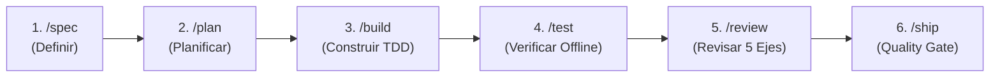

# 🛠️ Chatbot WS — Guía de Skills de Ingeniería y Workflows Agénticos

> **Estándar Operativo de Habilidades de Desarrollo, Calidad y Guardrails para Agentes de IA**  
> **Versión:** 1.0.0 (Certificación Institucional)  
> **Fecha de Aprobación:** Octubre de 2026  
> **Fuentes de Inspiración:** Addy Osmani (`agent-skills`), arXiv:2609.00006 (*Harness Engineering*) y Harness Institucional Chatbot WS  
> **Ámbito de Aplicación:** Antigravity, Claude Code, Cursor, Copilot y Desarrolladores de Chatbot WS / TrasladosYa  
> [← Volver a Estándares y Harness](README.md) | [Ir a Guía de Harness Engineering](GUIA_HARNESS_ENGINEERING.md) | [Ir al Índice General](../INDEX.md)

---

## 🎯 1. Filosofía: ¿Qué es una Skill de Ingeniería para IA?

Un agente de inteligencia artificial sin directrices de procedimiento tiende a operar de forma probabilística: resuelve problemas buscando el camino de menor resistencia ("hacer que funcione ya"), introduciendo parches ciegos, mutando código sin pruebas o asumiendo que un webhook de WhatsApp nunca fallará.

Las **Skills de Ingeniería** (popularizadas por Addy Osmani y formalizadas en el estudio empírico arXiv:2609.00006) no son textos decorativos: **son programas de procedimiento y flujos de trabajo ejecutables que codifican la disciplina y rigor de un Staff Software Engineer**.

```
┌─────────────────────────────────────────────────────────────────────────────┐
│                            LA FÓRMULA DEL ÉXITO                             │
│                                                                             │
│     Capacidad del Modelo + Harness Operativo + Skills de Ingeniería         │
│     = Software Determinista, Seguro, Auditable y Libre de Regresiones      │
└─────────────────────────────────────────────────────────────────────────────┘
```

Cada skill define cinco componentes inquebrantables:
1. **Gatillador (*When to use*):** Evento exacto que activa la habilidad.
2. **Proceso Paso a Paso (*Core Process*):** Flujo algorítmico ineludible.
3. **Matriz Anti-Racionalizaciones:** Tabla de excusas comunes de los modelos y sus contra-respuestas mandatorias.
4. **Banderas Rojas (*Red Flags*):** Señales inmediatas de que la disciplina está siendo violada.
5. **Criterio de Verificación de Salida (*Verification Gate*):** Pruebas objetivas obligatorias para dar por concluida la tarea.

---

## 🔄 2. Ciclo de Vida del Desarrollo en Chatbot WS (SDLC Agéntico de 6 Fases)

Cualquier nueva funcionalidad, módulo de movilidad, integración de pagos o corrección de bugs en Chatbot WS sigue rigurosamente este ciclo:



| Fase | Comando / Intención | Principio Rector Institucional | Evidencia de Aprobación |
|---|---|---|---|
| **1. DEFINE** | `/spec` | *Especificación antes que código:* Comprender el contrato, la máquina de estados y las tarifas antes de editar. | Esquema Zod tipado, migración SQL o contrato de interfaz documentado. |
| **2. PLAN** | `/plan` | *Tareas atómicas y rebanadas verticales:* Dividir el trabajo en pasos independientes y verificables. | Plan ordenado con dependencias explícitas, mitigación de fallos y rollback. |
| **3. BUILD** | `/build` | *Construcción incremental con Red-Green-Refactor:* Implementar una sola función o módulo a la vez. | Código modular con tipado TypeScript estricto (0 `any`, 0 dependencias circulares). |
| **4. VERIFY** | `/test` | *Las pruebas son la única prueba:* Demostrar el comportamiento con mocks deterministas. | Tests unitarios pasando al 100% con cero llamadas reales a Meta o Gemini. |
| **5. REVIEW** | `/review` | *Revisión multi-eje:* Auditar correctitud, arquitectura, seguridad y rendimiento. | Ausencia de secretos, RLS activo, latencia webhook `<1.5s`, cero `any`. |
| **6. SHIP** | `/ship` | *Despliegue seguro:* La compuerta automatizada es ley absoluta. | `npm run quality-gate` retorna código `0` (4/4 Verificaciones Superadas). |

---

## 🛡️ 3. La Matriz Anti-Racionalizaciones de Chatbot WS (Escudo Anti-Atajos)

Los modelos de IA y desarrolladores apresurados intentan constantemente justificar por qué pueden saltarse pasos. La siguiente matriz es de **cumplimiento obligatorio e inquebrantable**:

| Racionalización / Excusa Típica del Agente | Realidad Institucional en Chatbot WS | Acción Correctiva Obligatoria |
|---|---|---|
| *"El cambio es minúsculo (solo una línea o condición en el webhook), no requiere test."* | Un error en el webhook provoca bucles de reintentos masivos de Meta (20s timeout) y baneo del número. | Escribir un test unitario en Vitest con mock del payload de Meta o ejecutar la suite completa. |
| *"Dejaré que el LLM calcule la tarifa o el descuento dinámicamente en el prompt."* | Violación crítica del Grounding Lock (`AGENTS.md`). El LLM alucinará precios y regalará servicios. | Consultar la tarifa determinista en la base de datos SQL (`mobility_fare_matrix`) o función de pricing. |
| *"Pondré un `try/catch` vacío para que el servidor no se caiga si falla una API externa."* | Oculta fallos silenciosos, envenena la cola outbox y viola el principio de auto-aprendizaje. | Clasificar el error, registrarlo con Pino, activar fallback estructurado y documentar en `self_learning_error_catalog.md`. |
| *"Haré peticiones reales a Meta Graph API o a Gemini en los tests para probar que responde."* | Viola el Mandamiento D. Las pruebas deben ejecutarse offline de forma ágil y determinista. | Interceptar todas las llamadas de red con mocks deterministas (`vi.fn()`, `mockResolvedValue`). |
| *"Usaré `any` temporalmente en TypeScript porque el payload de WhatsApp es muy complejo."* | Viola el Mandamiento E. El uso de `any` destruye la seguridad en tiempo de compilación. | Modelar el payload con esquemas de `zod` (`z.infer<typeof WebhookPayloadSchema>`). |
| *"El usuario tiene prisa, así que concluiré la tarea sin correr el Quality Gate."* | Violación de la compuerta obligatoria. La tarea **NO está terminada** sin verificación física. | Ejecutar `npm run quality-gate` y verificar 100% de verificaciones superadas. |
| *"Importaré LangChain o CrewAI para orquestar el flujo conversacional."* | Viola la Doctrina de las Dos Ausencias (arXiv:2609.00006). Cero frameworks agénticos externos. | Implementar el bucle en primitivas nativas de Node/Fastify con tipado Zod. |
| *"Crearé un índice de embeddings vectoriales para buscar las tarifas de taxis."* | Ineficiente, probabilístico y propenso a errores de coincidencia de zonas. | Utilizar consultas SQL relacionales directas indexadas por `origin_zone_id` y `destination_zone_id`. |

---

## 🧰 4. Catálogo de Habilidades Clave de Chatbot WS

### Skill 1: `spec-driven-development` (Desarrollo Guiado por Especificación)
* **Gatillador:** Solicitud de nueva funcionalidad, nuevo flujo conversacional, nuevo endpoint o integración de canales (ej. Telegram choferes).
* **Proceso:**
  1. Definir el esquema Zod de entrada y salida con tipos explícitos y mensajes de error claros.
  2. Diseñar la migración SQL (`migrations/`) asegurando claves foráneas, índices y políticas RLS.
  3. Establecer el comportamiento en estado degradado (*fail-closed*: qué responder si Gemini cae o Meta rechaza el mensaje).
  4. Redactar la especificación en `docs/` antes de alterar archivos fuente.
* **Criterio de Salida:** Contrato Zod y prueba de esquema TypeScript compilando sin errores (`tsc --noEmit`).

---

### Skill 2: `test-driven-development` (Desarrollo Guiado por Pruebas Deterministas)
* **Gatillador:** Implementación de cualquier lógica de negocio, repositorio, guardrail o motor de movilidad.
* **Proceso (Red-Green-Refactor Estricto):**
  1. **Red:** Escribir el test en Vitest con casos límite (precios cero, zonas inexistentes, payloads truncados). Comprobar que falla por la razón esperada.
  2. **Green:** Implementar el código mínimo necesario para satisfacer el test.
  3. **Refactor:** Limpiar código, asegurar tipado estricto y eliminar redundancias.
  4. **Presupuesto:** Garantizar que los tests corran de forma aislada sin acceso a internet.
* **Criterio de Salida:** `npm test` pasa al 100% de las suites sin peticiones de red reales.

---

### Skill 3: `systematic-debugging` (Depuración Sistemática Stop-the-Line)
* **Gatillador:** Reporte de bug, fallo en tests, rechazo de webhook de Meta o error en outbox.
* **Proceso (Protocolo de 5 Pasos):**
  1. **Reproducir:** Crear un test en Vitest que simule exactamente el payload o condición de carrera que provocó la falla.
  2. **Localizar:** Rastrear el error hasta el módulo y línea exacta utilizando trazas de Pino y análisis estático.
  3. **Reducir:** Aislar el caso mínimo reproducible eliminando variables accesorias.
  4. **Corregir:** Resolver la causa raíz estructural en el código de producción. **Prohibido colocar parches ciegos o `try/catch` vacíos**.
  5. **Proteger & Aprender:** Incorporar el test como tripwire permanente y documentar el análisis formal de 5-Whys en `docs/standards_and_harness/self_learning_error_catalog.md`.
* **Criterio de Salida:** Bug resuelto, test protector permanente y entrada catalogada con código `[ERR-XXX]`.

---

### Skill 4: `code-review-and-quality` (Revisión de Código en Cinco Ejes)
* **Gatillador:** Antes de cerrar cualquier tarea, preparar un commit o proponer una integración.
* **Los 5 Ejes de Auditoría:**
  1. **Correctitud Funcional:** ¿Cumple con la máquina de estados? ¿Maneja idempotencia de `wamid` y reclamo atómico de viajes?
  2. **Arquitectura & Tipado:** ¿`tsc --noEmit` compila con 0 errores? ¿Cero `any`? ¿Cero dependencias circulares?
  3. **Seguridad Zero-Trust:** ¿Cero credenciales en código? ¿Validación HMAC `x-hub-signature-256`? ¿RLS activo en PostgreSQL?
  4. **Rendimiento & SLA:** ¿Respuesta de webhook `<1.5s`? ¿Event loop de Node.js 100% asíncrono y no bloqueante?
  5. **UX Conversacional:** ¿Mensajes con formato nativo de WhatsApp (negritas `*`, listas, emojis moderados)? ¿Límites de caracteres respetados?
* **Criterio de Salida:** Lista de verificación de 5 ejes aprobada sin observaciones críticas.

---

### Skill 5: `interface-and-api-contract-design` (Diseño de Contratos e Interfaces de API)
* **Gatillador:** Creación o modificación de endpoints de webhook, payloads de Meta Cloud API o APIs internas.
* **Proceso:**
  1. **Principio de Hyrum:** Asumir que Meta o clientes de terceros cambiarán o agregarán campos en el webhook; validar con Zod de forma permisiva en campos opcionales (`passthrough()` o campos opcionales) pero estricta en obligatorios.
  2. **Zero-DDL en Runtime:** Almacenar metadatos dinámicos en columnas `jsonb` indexadas (ej. `payload`, `raw_event`) sin alterar esquemas físicos en caliente.
  3. **Errores Remediales:** Los errores de tools para el LLM deben explicar claramente la acción correctiva para permitir la auto-recuperación.
* **Criterio de Salida:** Contratos Zod tipados y validados contra la documentación oficial de Meta v21.0.

---

## 🚀 5. Cómo Invocar y Usar estas Skills en tu Flujo de Trabajo

### En Sesiones de Asistente IA (Antigravity / Claude / Cursor):
* Invocar el modo planificador con `/plan` ante cualquier tarea compleja o refactorización.
* Ante un fallo inesperado, solicitar: *"Aplica el protocolo systematic-debugging para resolver este bug y documenta el 5-Whys"*.
* Recordar al inicio de la sesión: *"Sigue estrictamente la Guía de Skills y la Matriz Anti-Racionalizaciones antes de proponer cambios"*.

### Verificación Automatizada (Stop-Guard Institucional):
Antes de dar por concluida cualquier tarea o proponer un commit:
```bash
npm run quality-gate
```
Si el resultado no es `100% de Verificaciones Superadas`, **la tarea NO está terminada y se debe continuar hasta resolver la causa raíz**.

---

## 📚 6. Enlaces y Documentación Relacionada
* [Harness Institucional (`AGENTS.md`)](../../AGENTS.md)
* [Guía de Harness Engineering v3.0.0 (`GUIA_HARNESS_ENGINEERING.md`)](GUIA_HARNESS_ENGINEERING.md)
* [Catálogo de Errores con Auto-Aprendizaje (`self_learning_error_catalog.md`)](self_learning_error_catalog.md)
* [Estándares de Ingeniería (`ENGINEERING_STANDARDS.md`)](ENGINEERING_STANDARDS.md)
